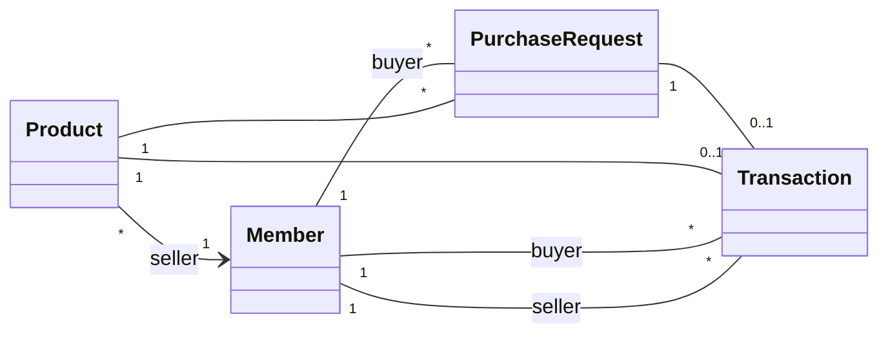
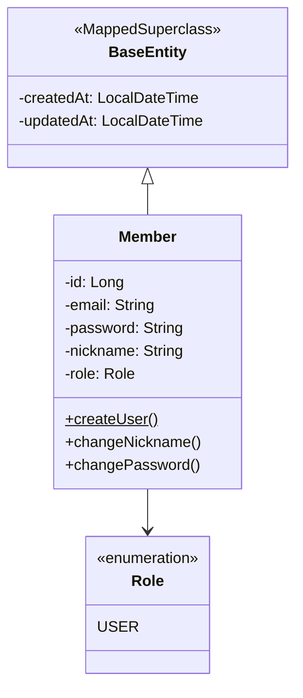
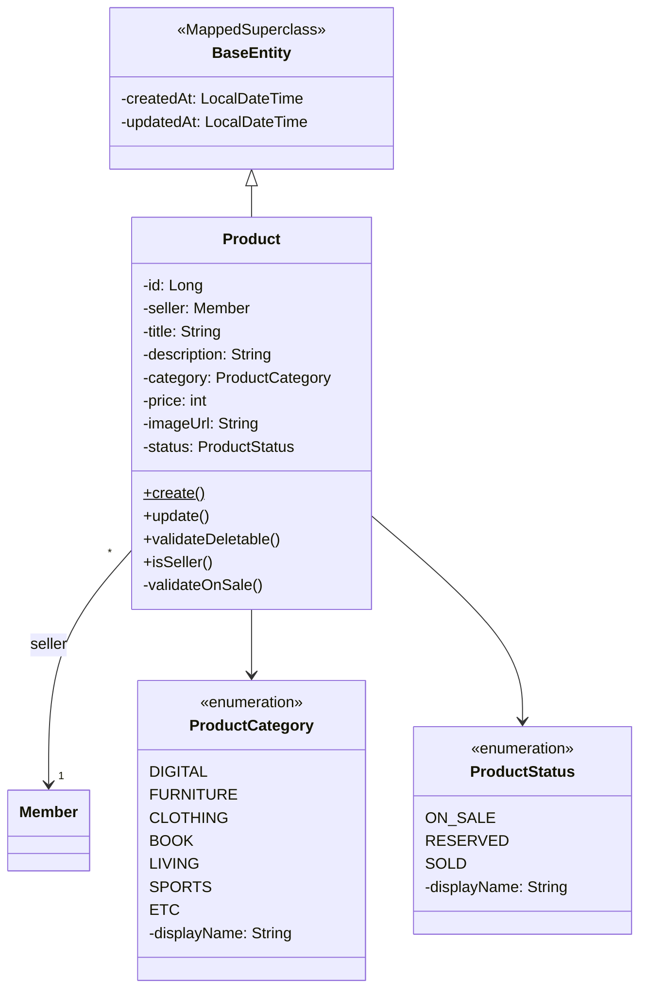

# 클래스 다이어그램

> 초안, 구현하며 갱신

## 1. 개요

- 화살표는 객체 참조 방향을 나타냄. Product → Member(seller)는 단방향 참조로 확정.
- 화살표 없는 실선은 ERD 기준 관계이며, 참조 방향은 Transaction 단계에서 정함.
- PurchaseRequest, Transaction은 Transaction 단계에서 상세화함.

## 2. Member 상세

- password는 BCrypt 해시가 저장됨. 인코딩은 Service에서 하고 엔티티는 인코딩된 값만 받음.
- role은 enum 이름을 VARCHAR로 저장함 (ADR 0014).

## 3. Product 상세

- 메서드 파라미터는 다이어그램에서 생략하며, 시그니처는 코드를 기준으로 함.
- create()는 상태를 항상 ON_SALE로 시작함.
- update(), validateDeletable()은 ON_SALE이 아니면 예외를 던짐 (ADR 0005).
- isSeller()는 판매자 본인 여부만 반환하며, 권한 거부는 Service가 담당함 (ADR 0015).
- category, status는 enum 이름을 VARCHAR로 저장함 (ADR 0014).
- isDeleted 필드와 상태 전이 메서드(예약, 판매완료)는 Transaction 단계에서 추가함.
